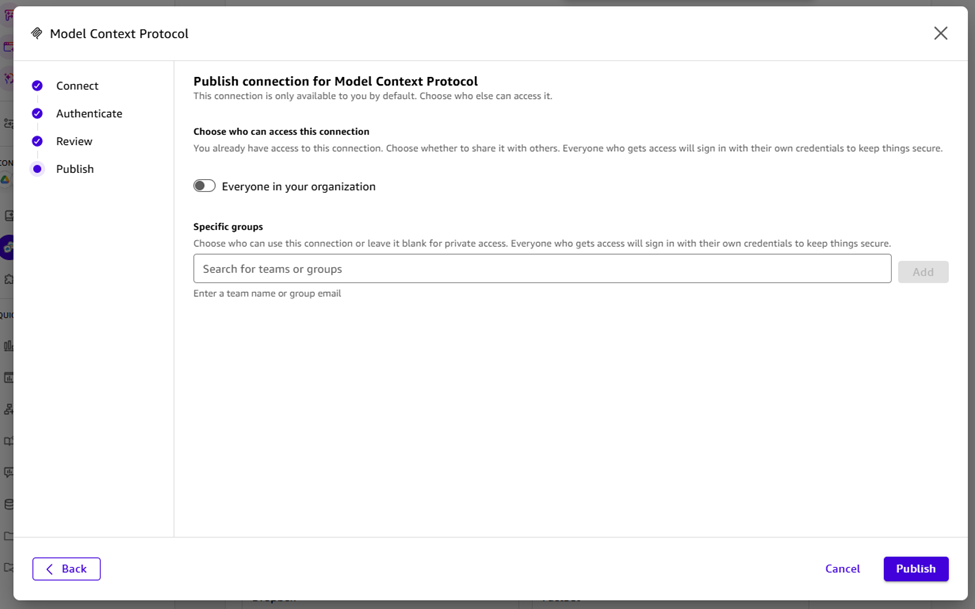

# MCP Server Setup Guide for Amazon Quick

**Version:** 1.0
**Publication Date:** 2026

## About this Document

The MCP Server Setup Guide provides step-by-step instructions for setting up Dun & Bradstreet's MCP server for your Amazon Quick instance.

---

## Table of Contents

- [Requirements to Connect to Dun & Bradstreet MCP Server](#requirements-to-connect-to-dun--bradstreet-mcp-server)
- [Navigate to MCP Settings](#navigate-to-mcp-settings)
- [Add a New MCP Connection](#add-a-new-mcp-connection)
- [Finalize Connection and Add Users](#finalize-connection-and-add-users)

---

## Requirements to Connect to Dun & Bradstreet MCP Server

Before starting, ensure you have the following:

- An active **Amazon Quick** account
- Access to the **Amazon Quick MCP configuration screen**
- The following credentials provided by **Dun & Bradstreet** as part of your D&B Direct+ and D&B.AI Data Package subscriptions:
  - **Client ID** (provided separately)
  - **Client Secret** (provided separately)
  - **Base URL:** [https://plus.dnb.com/v2/mcp](https://plus.dnb.com/v2/mcp)
  - **OAuth 2.0 Authorization Endpoint:** [https://plus.dnb.com/v2/mcp/authorize](https://plus.dnb.com/v2/mcp/authorize)
  - **OAuth 2.0 Token Endpoint:** [https://plus.dnb.com/v2/mcp/token](https://plus.dnb.com/v2/mcp/token)
- Network access that allows outbound calls to D&B endpoints

---

## Navigate to MCP Settings

1. Log into [Amazon Quick](https://quicksight.aws.amazon.com/).

2. Navigate to **Connectors** > **Available**.

3. In the search bar within the Connectors tab, enter "Dun & Bradstreet" and select the appropriate tile.

   

---

## Add a New MCP Connection

1. Click **Connect** on the Dun & Bradstreet tile to begin the setup process.

2. If prompted, fill out the following required fields:
   - **Base URL** — `https://plus.dnb.com/v2/mcp`
   - **Client ID** (provided via email from D&B)
   - **Client Secret** (provided via email from D&B)
   - **Token URL** — `https://plus.dnb.com/v2/mcp/token`
   - **Authorization URL** — `https://plus.dnb.com/v2/mcp/authorize`

   

---

## Finalize Connection and Add Users

1. Once a connection has been established, you will be prompted to continue to the tools page.

2. Review the list of available tools within the MCP server. Click **Next** to proceed.

   > **Note:** All tools will be listed within this page, including tools for Dun & Bradstreet Data Blocks that you may not have an active subscription for. To add additional Data Blocks to your subscription, contact your Dun & Bradstreet representative.

   

3. You will now be prompted to select which team members will have access to the Dun & Bradstreet MCP Connector. You can choose to entitle all users within your organization, or select from specific teams and groups.

   

4. Click **Publish** to finalize.

5. You have now completed your connection to Dun & Bradstreet's MCP server. For additional support, visit [service.dnb.com](https://service.dnb.com) or contact your Dun & Bradstreet representative.
