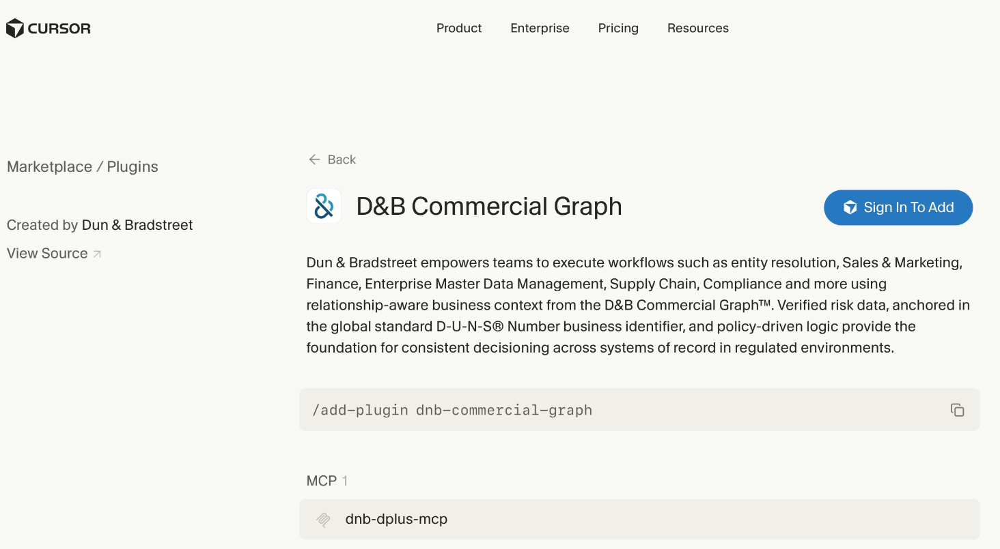
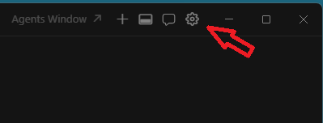
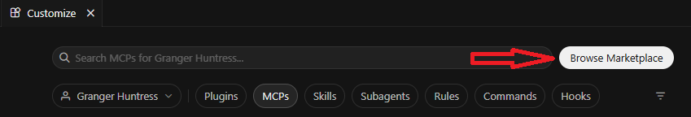
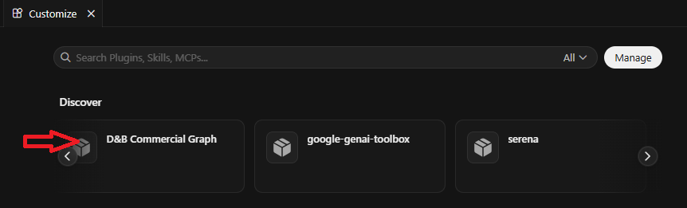
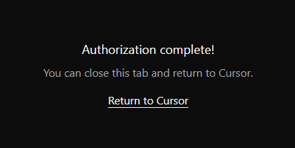
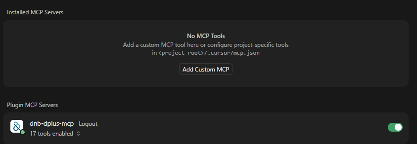
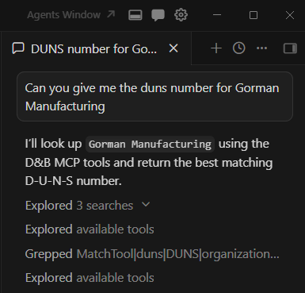
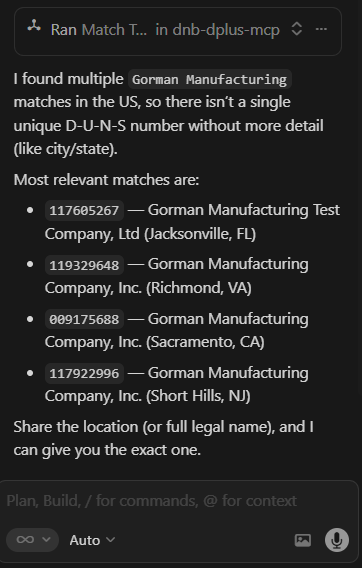

# MCP Server Setup Guide for Cursor

**Version:** 1.0
**Publication Date:** 2026

## About this Document

The MCP Server Setup Guide provides step-by-step instructions for setting up Dun & Bradstreet's MCP server for a Cursor application.

---

## Table of Contents

- [Requirements to Connect to Dun & Bradstreet MCP Server](#requirements-to-connect-to-dun--bradstreet-mcp-server)
- [Create an MCP Connection](#create-an-mcp-connection)
- [Validate Credentials](#validate-credentials)
- [Test MCP Connection](#test-mcp-connection)

---

## Requirements to Connect to Dun & Bradstreet MCP Server

Before starting, ensure you have the following:

- An active **Cursor** account and the standalone application
- **Cursor** 2.5+
- The following credentials provided by **Dun & Bradstreet** as part of your D&B Direct+ and D&B.AI Data Package subscriptions:
  - **Client ID** (provided separately)
  - **Client Secret** (provided separately)

---

## Create an MCP Connection

1. Log into the Cursor application.

2. **Set your Dun & Bradstreet Commercial Graph credentials into your environment.**

   **macOS/Linux** (`~/.zshrc` or `~/.bashrc`):

   ```bash
   export DNB_DIRECT_PLUS_MCP_CLIENT_ID=your_client_id
   export DNB_DIRECT_PLUS_MCP_CLIENT_SECRET=your_client_secret
   ```

   **Windows** (System Properties → Environment Variables or PowerShell):

   ```powershell
   [System.Environment]::SetEnvironmentVariable("DNB_DIRECT_PLUS_MCP_CLIENT_ID","your_client_id","User")
   [System.Environment]::SetEnvironmentVariable("DNB_DIRECT_PLUS_MCP_CLIENT_SECRET","your_client_secret","User")
   ```

### There are two ways to install the MCP Connection

#### Method 1

1. Find the MCP Server in the Cursor Marketplace with your browser.

   

2. Click **Sign In to Add**, or type `/add-plugin dnb-commercial-graph` from your Agent Window.

3. It will then follow the same security checks as described in [Validate Credentials](#validate-credentials) below.

#### Method 2

1. Open Cursor Settings (`Cmd+,` / `Ctrl+,`) or click the gear icon at the top right.

   

2. Go to **Tools & MCPs**.

3. Click **Open Customize**.

   

4. Search for `dnb-dplus-plugin-cursor`.

   

5. Click **Install**.

---

## Validate Credentials

In both methods you will be required to validate your credentials. If the environment variables are correctly set, it will take you to a browser and validate.



> **Note:** Sometimes you will be asked to restart Cursor (or reload the window via `Ctrl+Shift+P` → **Developer: Reload Window**) so the environment variables are loaded.

After reloading Cursor, the plugin will automatically attempt to connect to the D&B Commercial Graph MCP Server.

---

## Test MCP Connection

1. Verify your connection within **Settings** > **Tools and MCP**. You should see the `dnb-dplus-mcp` server listed under Plugin MCP Servers with a green indicator and tools enabled.

   

2. Within your Agent Window, ask a question. If you are connected, Cursor will call the MCP.

   

3. Cursor returns a response.

   
