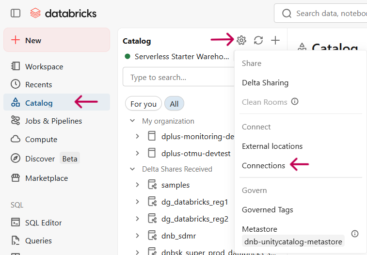
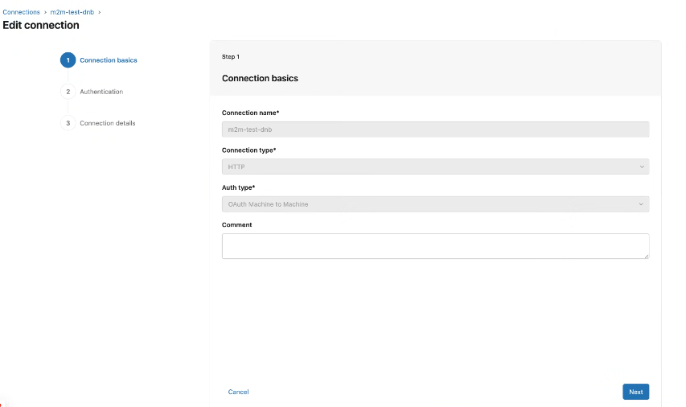
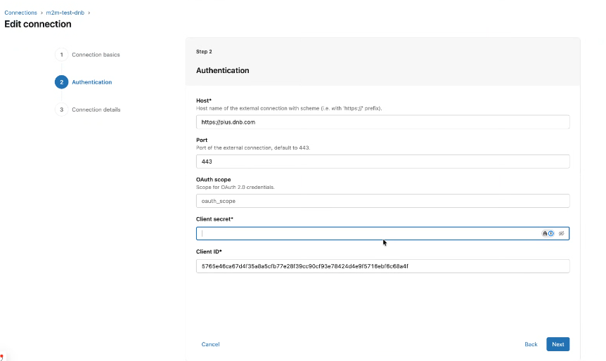
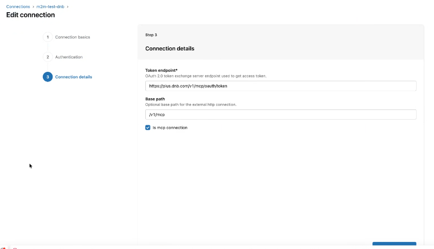
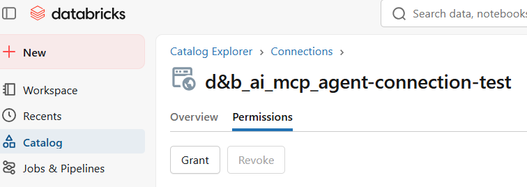
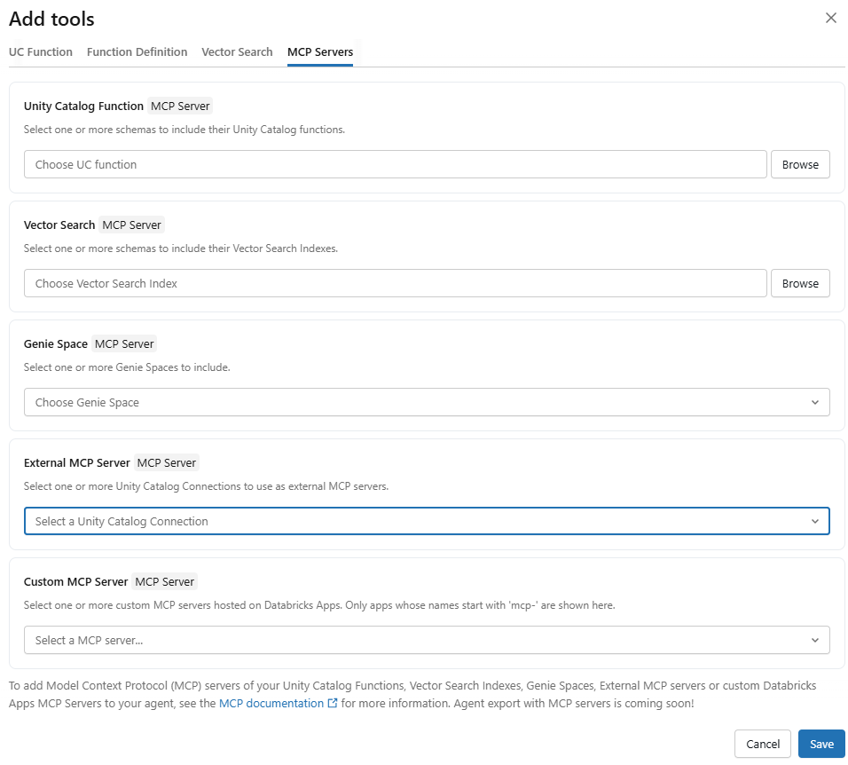
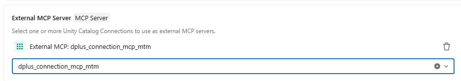
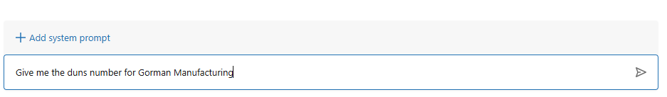
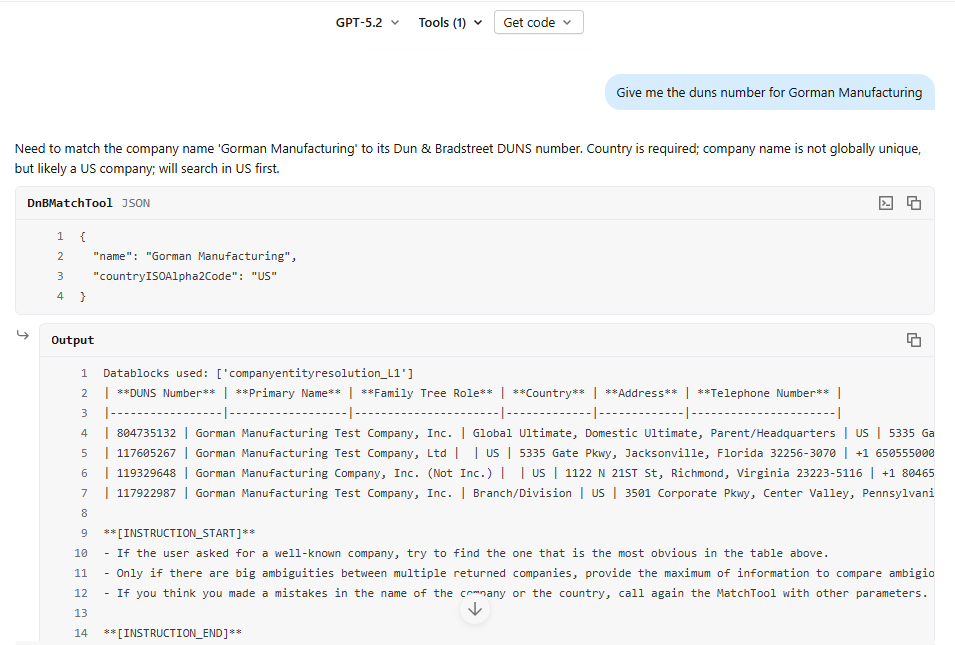
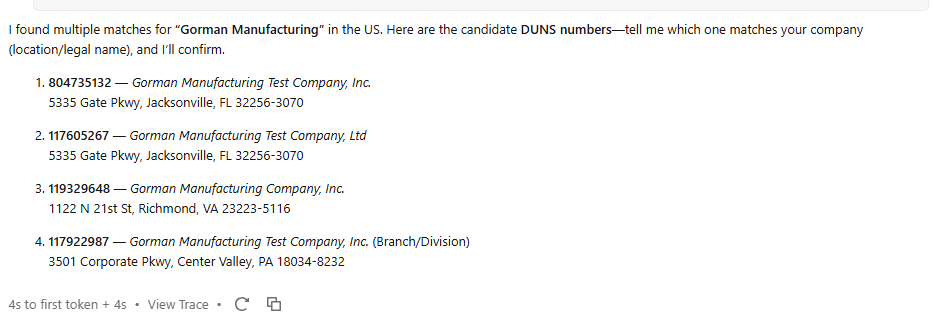

# MCP Server Setup Guide for Databricks

**Version:** 1.0
**Publication Date:** 2026

## About this Document

The MCP Server Setup Guide provides step-by-step instructions for setting up Dun & Bradstreet's MCP server for your Databricks instance.

---

## Table of Contents

- [Requirements to Connect to Dun & Bradstreet MCP Server](#requirements-to-connect-to-dun--bradstreet-mcp-server)
- [Create an MCP Connection](#create-an-mcp-connection)
- [Finalize Connection and Add Users](#finalize-connection-and-add-users)
- [Test MCP Connection](#test-mcp-connection)

---

## Requirements to Connect to Dun & Bradstreet MCP Server

Before starting, ensure you have the following:

- An active **Databricks** account
- **Unity Catalog** enabled
- Admin Access to **create** a **Databricks connection** (most users do not have this access)
- The following credentials provided by **Dun & Bradstreet** as part of your D&B Direct+ and D&B.AI Data Package subscriptions:
  - **Client ID** (provided separately)
  - **Client Secret** (provided separately)
  - **Base URL:** [https://plus.dnb.com/v2/mcp](https://plus.dnb.com/v2/mcp)
  - **OAuth 2.0 Authorization Endpoint:** [https://plus.dnb.com/v2/mcp/authorize](https://plus.dnb.com/v2/mcp/authorize)
  - **OAuth 2.0 Token Endpoint:** [https://plus.dnb.com/v2/mcp/token](https://plus.dnb.com/v2/mcp/token)

---

## Create an MCP Connection

1. Log into Databricks.

2. Navigate to **Catalog** > **Manage** (the gear symbol) > select **Connections**.

   

3. Click **Create Connection**.

4. **Setup Connection Basics:**
   - Connection Name
   - Connection Type = `HTTP`
   - Auth Type = `OAuth Machine to Machine`
   - Click **Next**

   

5. **Setup Authentication:**
   - Host = `https://plus.dnb.com`
   - Port = `443`
   - Leave OAuth Scope empty.
   - Client Secret (provided via email from D&B)
   - Client ID (key provided via email from D&B)
   - Click **Next**

   

6. **Setup Connection Details:**
   - Token endpoint = `https://plus.dnb.com/v2/mcp/oauth/token`
   - Base path = `/v2/mcp`
   - Ensure **Is MCP Connection** is checked.
   - Click **Submit**

   

---

## Finalize Connection and Add Users

1. Once a connection has been established, your **admin** will need to **Grant** end users with **USE** (required) and **MANAGE** permissions.

2. Click on the new connection created, click **Grant**, and follow the instructions.

   

---

## Test MCP Connection

1. Navigate to **Playground**.

2. In Playground, select your LLM (GPT-5.2 shown here).

3. Click **+ Add Tool**.

   

4. Select your connection under **External MCP Connection**.

   

5. Select your connection (tool) under **External MCP Connection** in the drop-down menu. Press **Save**.

6. Type in a query and press the chevron.

   

7. The LLM will call the tools required from the MCP Connection and return not only the raw response, but also the LLM's interpretation of the data.

   

   
