# MCP Server Setup Guide for IBM WatsonX Orchestrate

**Version:** 1.0
**Publication Date:** 2026

## About this Document

The MCP Server Setup Guide provides step-by-step instructions for setting up Dun & Bradstreet's MCP server for your IBM WatsonX Orchestrate instance.

---

## Table of Contents

- [Requirements to Connect to Dun & Bradstreet MCP Server](#requirements-to-connect-to-dun--bradstreet-mcp-server)
- [Create an MCP Connection](#create-an-mcp-connection)
- [Add MCP Tool to Agent and Connect](#add-mcp-tool-to-agent-and-connect)
- [Test MCP Connection](#test-mcp-connection)

---

## Requirements to Connect to Dun & Bradstreet MCP Server

Before starting, ensure you have the following:

- An active **IBM WatsonX Orchestrate** account
- The following credentials provided by **Dun & Bradstreet** as part of your D&B Direct+ and D&B.AI Data Package subscriptions:
  - **Client ID** (provided separately)
  - **Client Secret** (provided separately)
  - **OAuth Token Endpoint:** [https://plus.dnb.com/v1/mcp/token](https://plus.dnb.com/v1/mcp/token)
- **Token** obtained via Postman or another application (token expires after four hours)
- The ability to create an agent within WatsonX Orchestrate

---

## Create an MCP Connection

1. Log into WatsonX Orchestrate.

2. Create an agent "from scratch".

3. Next, create a connection. Navigate to the hamburger menu: **Hamburger** > **Manage** > select **Security**.

   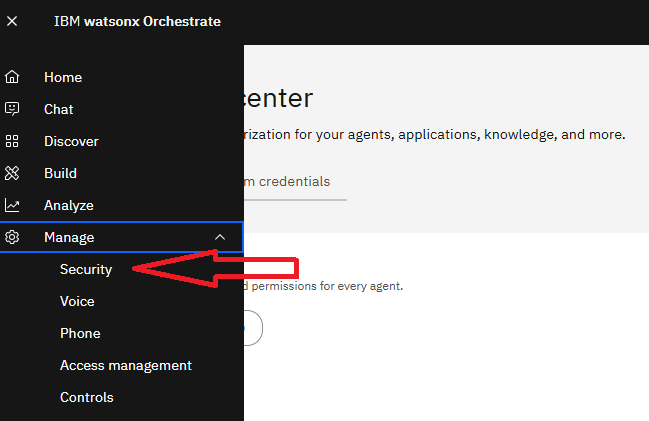

4. Click **Add Connection**.

   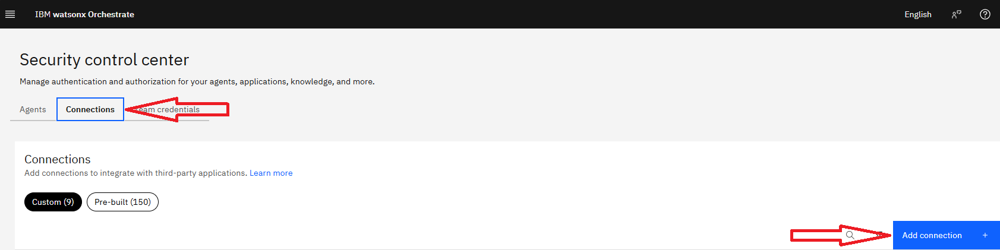

5. **Setup Connection Basics:**
   - Connection Name
   - Connection Display Name
   - Connection description
   - Click **Save and continue**

   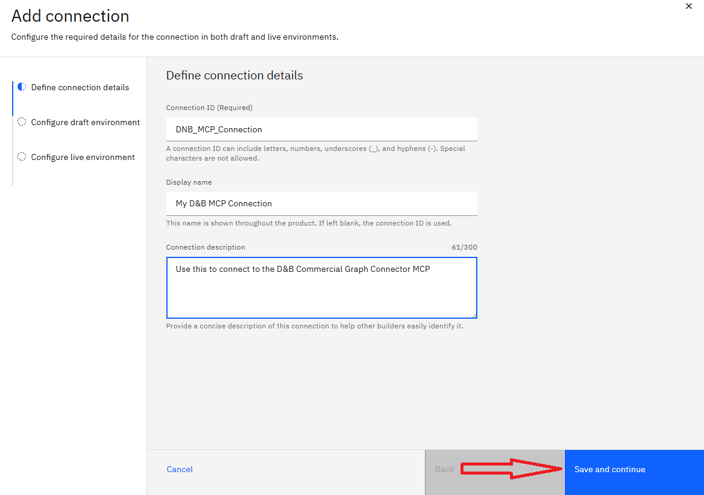

6. **Setup Draft Environment:**
   - Authentication Type = `Bearer Token`
   - Credential Type = `Team Credentials`
   - Bearer Token = your token
   - Click **Next**

   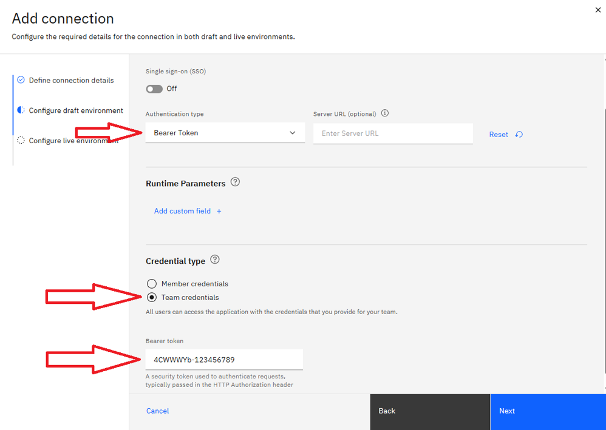

7. **Setup Live Environment:**
   - Authentication Type = `Bearer Token`
   - Credential Type = `Team Credentials`
   - Bearer Token = your token
   - Click **Finish**

   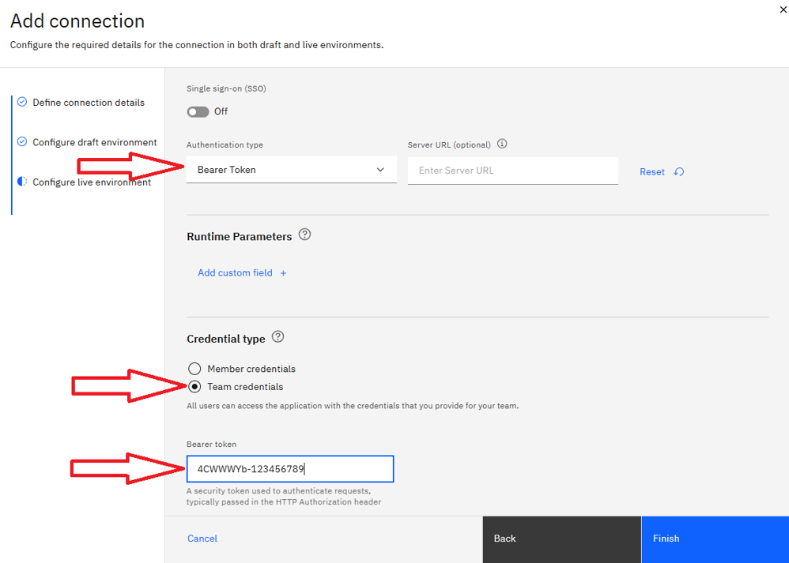

---

## Add MCP Tool to Agent and Connect

1. Once a connection has been established, return to **Edit** your agent.

2. Click **Add Tool**.

   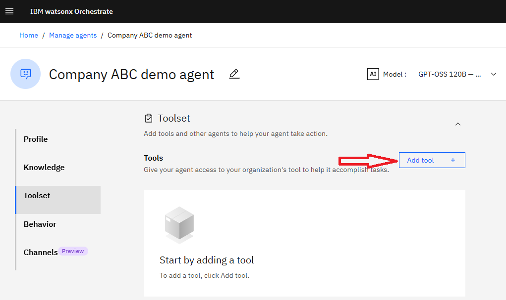

3. Select **Catalog**.

   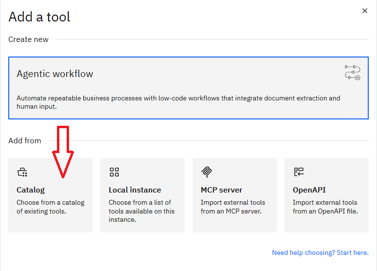

4. Select the **D&B Direct+ MCP Server** tool.

   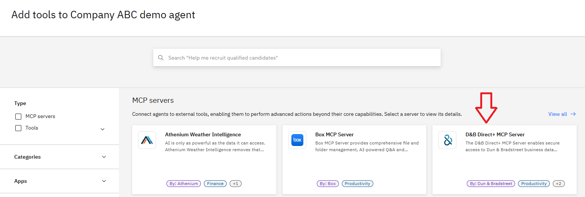

5. Click **Add to Agent**.

   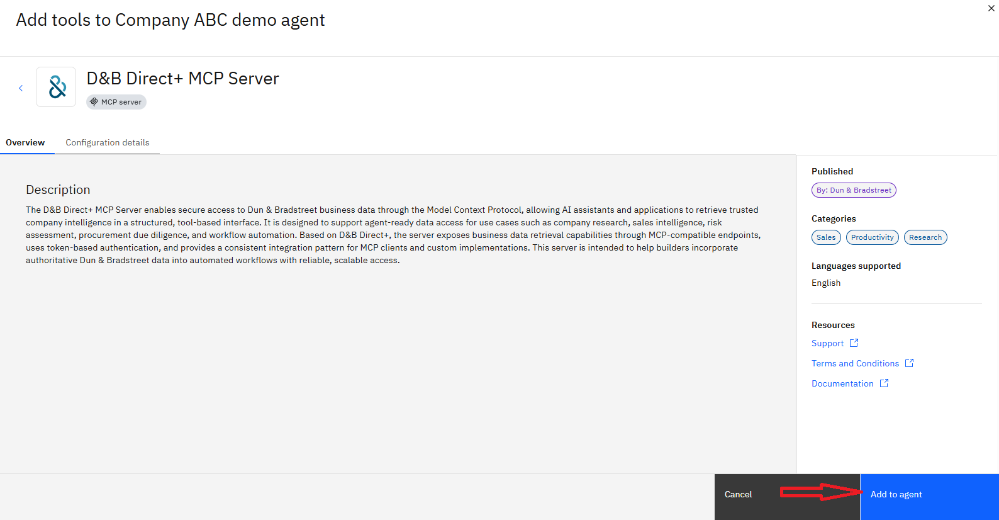

6. Select the connection you just created and click **Connect**.

   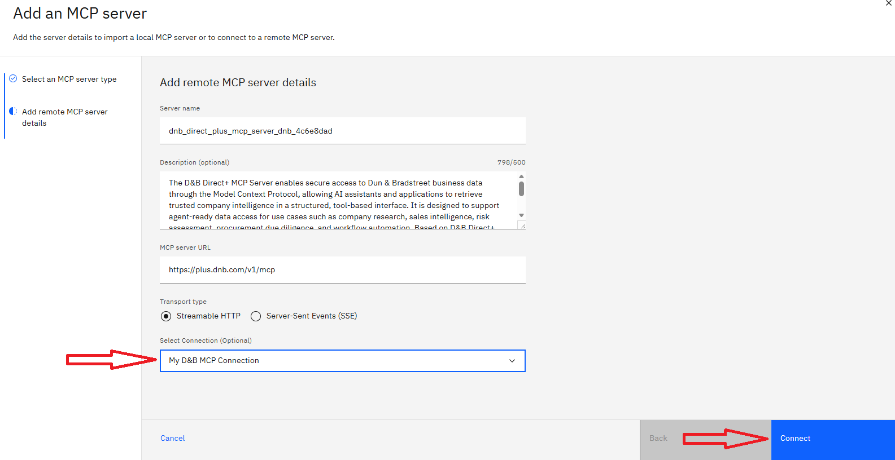

7. **Select the specific tools that the MCP uses.** Depending on the use case and the Data Blocks you are entitled to, this could vary. For this demonstration, all tools are selected.

8. Click **Add to Agent**.

   

---

## Test MCP Connection

1. You should now see all the tools added under **Tools**. Ask WatsonX a question — for example: *"Can you give me the DUNS number for Gorman Manufacturing and the address?"*

   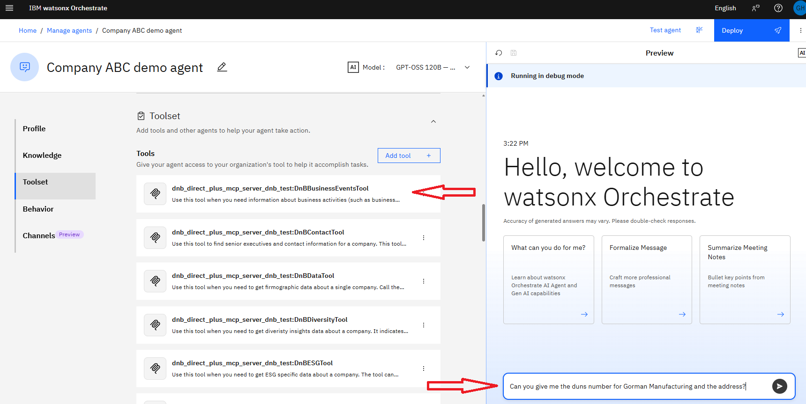

2. The LLM will call the tools required from the MCP and return the LLM's interpretation of the data.

   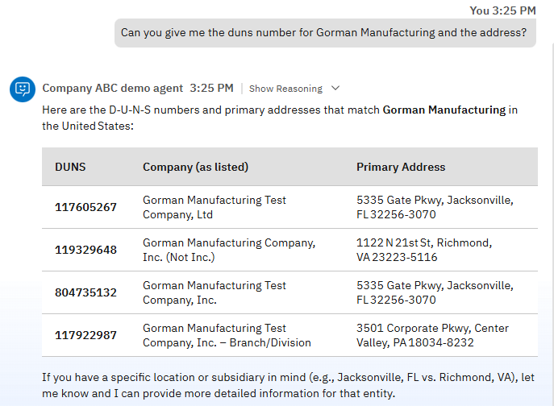

3. If you would like to see what happened in the background, toggle **Show Reasoning** and you will see the tool(s) called, as well as the raw JSON response.

   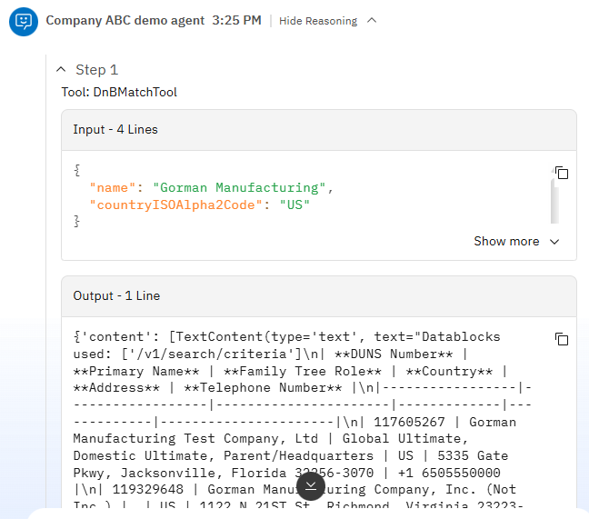
