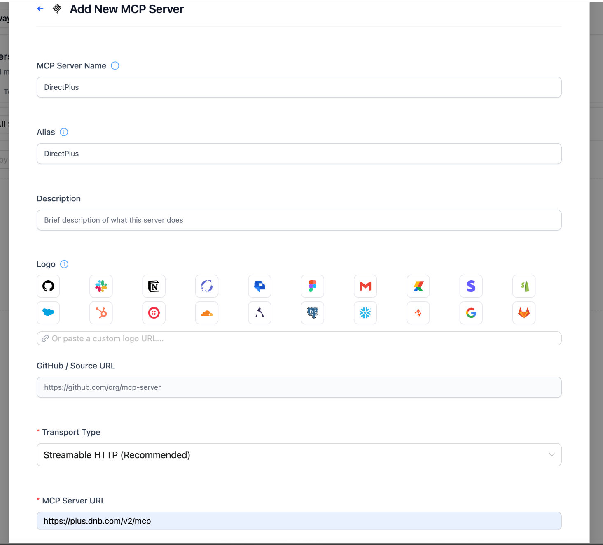
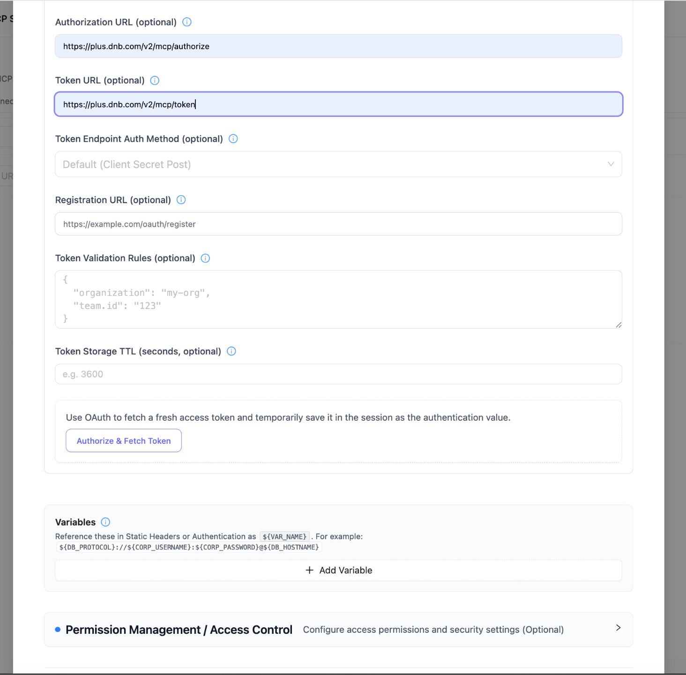

# MCP Server Setup Guide for LiteLLM

**Version:** 1.0
**Publication Date:** 2026

## About this Document

The MCP Server Setup Guide provides step-by-step instructions for setting up Dun & Bradstreet's MCP server for a LiteLLM integration.

---

## Table of Contents

- [Requirements to Connect to Dun & Bradstreet MCP Server](#requirements-to-connect-to-dun--bradstreet-mcp-server)
- [Create an MCP Connection](#create-an-mcp-connection)
- [Test MCP Connection](#test-mcp-connection)

---

## Requirements to Connect to Dun & Bradstreet MCP Server

Before starting, ensure you have the following:

- An active **LiteLLM** account and the standalone application
- The following credentials provided by **Dun & Bradstreet** as part of your D&B Direct+ and D&B.AI Data Package subscriptions:
  - **Client ID** (provided separately)
  - **Client Secret** (provided separately)

---

## Create an MCP Connection

1. Click **MCP Servers** and click the **Add New MCP Server** button.

2. Fill in the appropriate information:

   - **Transport Type** — Streamable HTTP
   - **MCP Server URL** — `https://plus.dnb.com/v2/mcp`
   - **Authentication** — OAuth
   - **OAuth Flow Type** — Interactive (PKCE)

   

3. Enter your D&B credentials.

   

   

---

## Test MCP Connection

1. **Check Tool Configuration.** Verify that the tools are enabled for user access under the Tool Configuration section. You should see all tools listed with a green check and the status showing tools enabled for user access.

   

2. **Use the Tool Testing Playground to test the server.** Navigate to the DirectPlus server's MCP Tools tab. Select a tool such as MatchTool, enter test parameters (e.g. country code "US" and name "ibm"), and verify a successful result.

   
