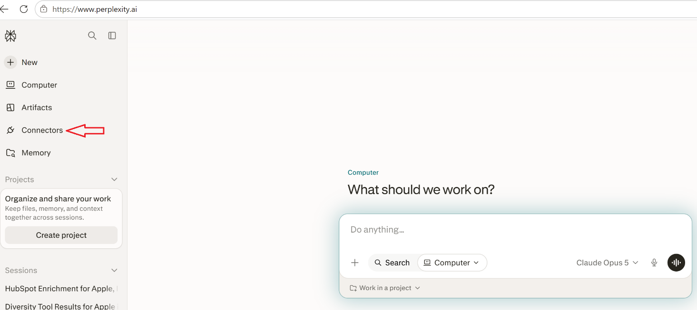
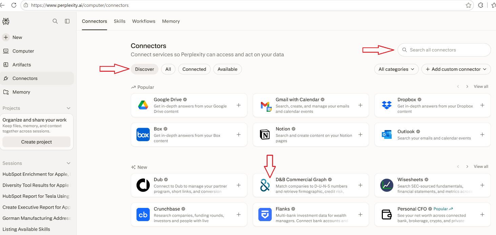
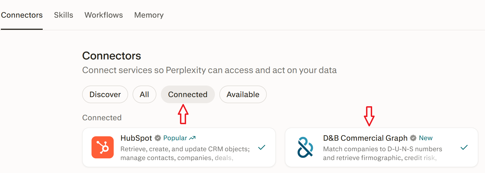

# MCP Server Setup Guide for Perplexity

**Version:** 1.0
**Publication Date:** 2026

## About this Document

The MCP Server Setup Guide provides step-by-step instructions for setting up Dun & Bradstreet's MCP server for a Perplexity application.

---

## Table of Contents

- [Requirements to Connect to Dun & Bradstreet MCP Server](#requirements-to-connect-to-dun--bradstreet-mcp-server)
- [Admin Management Within Perplexity](#admin-management-within-perplexity)
- [Finalize an MCP Connection for Users](#finalize-an-mcp-connection-for-users)
- [Test MCP Connection](#test-mcp-connection)

---

## Requirements to Connect to Dun & Bradstreet MCP Server

Before starting, ensure you have the following:

- An active **Perplexity** account and the standalone application
- The following credentials provided by **Dun & Bradstreet** as part of your D&B Direct+ and D&B.AI Data Package subscriptions:
  - **Client ID** (provided separately)
  - **Client Secret** (provided separately)

---

## Admin Management Within Perplexity

You can find the most complete instructions on how to manage permissions and users directly on the Perplexity website at [https://www.perplexity.ai/help-center/en/articles/12067853-introduction-to-organization-admins](https://www.perplexity.ai/help-center/en/articles/12067853-introduction-to-organization-admins).

---

## Finalize an MCP Connection for Users

1. Log into the Perplexity application.

2. Click **Connectors** on the left-hand side.

   

3. Search for **D&B Commercial Graph**.

4. Click the **+** symbol on the D&B Commercial Graph tile.

   

5. Click **+ Add Connector**.

   

6. You will be asked for your key and secret. Enter those in the form, then press **Submit**.

7. You will be redirected to Dun & Bradstreet for authentication. Once it is completed, you can close that window and proceed to use the connector.

---

## Test MCP Connection

1. Verify your connection within **Customize** > **Connectors** > **Connected**. You should see the D&B Commercial Graph tile with a checkmark.

   

2. If you do not see the D&B Commercial Graph, follow the steps above to reconnect.

3. Within your Agent Window, under **Computer** mode, ask a question.

4. Perplexity returns a response.

   
